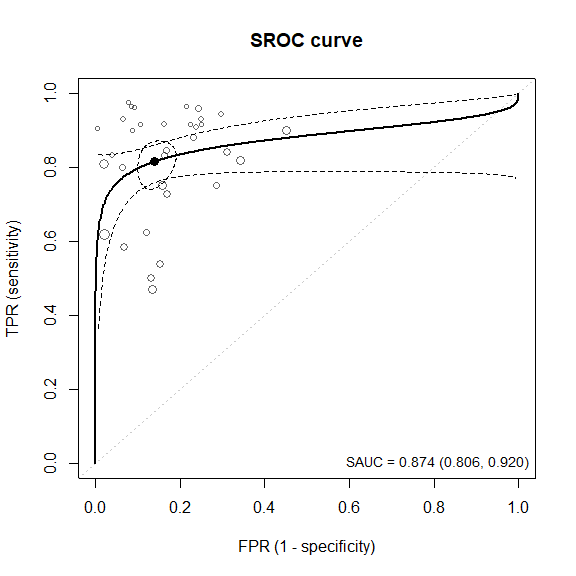
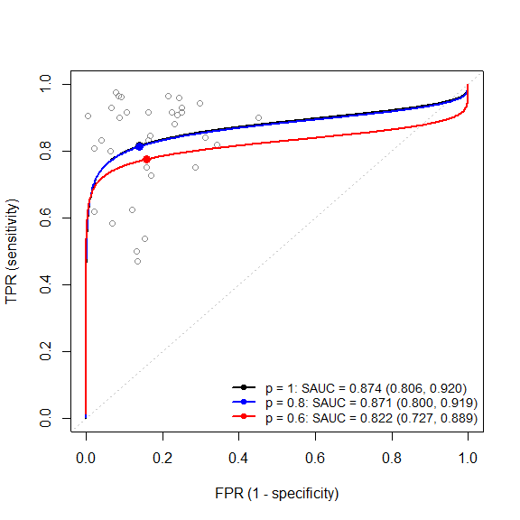
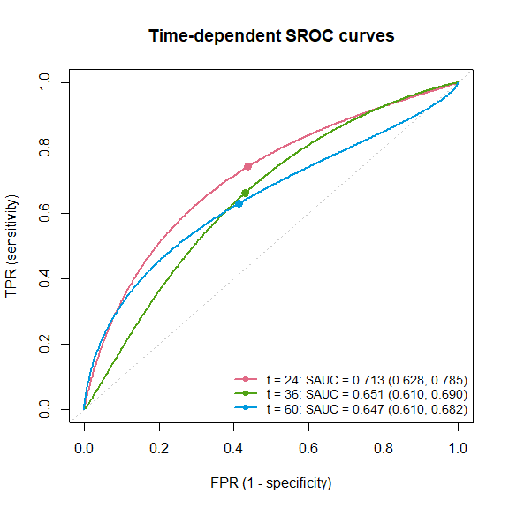
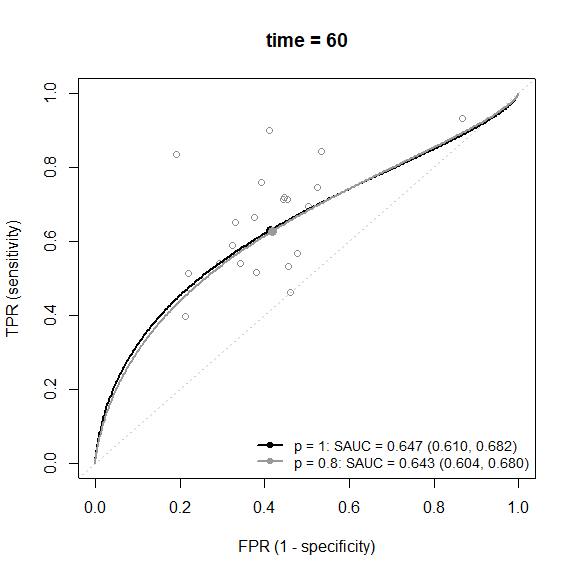
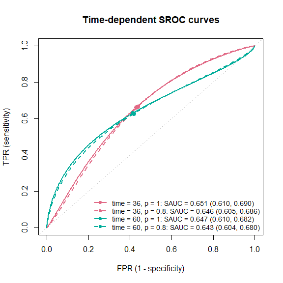

- [DiagProMeta](#diagprometa)
  - [Installation](#installation)
  - [Example 1: diagnostic studies (SROC
    curve)](#example-1-diagnostic-studies-sroc-curve)
    - [Without publication bias:
      `reitsma.sroc()`](#without-publication-bias-reitsmasroc)
    - [Sensitivity analysis for publication bias:
      `srocsa.t()`](#sensitivity-analysis-for-publication-bias-srocsat)
  - [Example 2: prognostic studies (time-dependent SROC
    curve)](#example-2-prognostic-studies-time-dependent-sroc-curve)
    - [Without publication bias:
      `hattori.tsroc()`](#without-publication-bias-hattoritsroc)
    - [Sensitivity analysis for publication bias:
      `tsrocsa.lrt()`](#sensitivity-analysis-for-publication-bias-tsrocsalrt)
  - [Methods](#methods)
    - [SROC curve (`reitsma.sroc`)](#sroc-curve-reitsmasroc)
    - [Sensitivity analysis on the SROC curve
      (`srocsa.t`)](#sensitivity-analysis-on-the-sroc-curve-srocsat)
    - [Time-dependent SROC curve
      (`hattori.tsroc`)](#time-dependent-sroc-curve-hattoritsroc)
    - [Sensitivity analysis on the time-dependent SROC curve
      (`tsrocsa.lrt`)](#sensitivity-analysis-on-the-time-dependent-sroc-curve-tsrocsalrt)
  - [Functions](#functions)
    - [Methods](#methods-1)
  - [Data](#data)
  - [References](#references)
  - [License](#license)

<!-- README.md is generated from README.Rmd. Please edit README.Rmd, then run devtools::build_readme(). -->

# DiagProMeta

**Meta-analysis of diagnostic and prognostic studies: SROC curves and
sensitivity analysis for publication bias**

`DiagProgMeta` is an R package for the meta-analysis of

- **diagnostic test accuracy (DTA) studies**: the summary receiver
  operating characteristic (SROC) curve and the area under the SROC
  curve (SAUC) by the bivariate random-effects model (Reitsma et al.,
  2005), and
- **prognostic studies**: the time-dependent SROC curve and SAUC, where
  the time-dependent sensitivity and specificity are reconstructed from
  the published survival probabilities (Combescure et al., 2016; Hattori
  and Zhou, 2016),

each with a **likelihood-based sensitivity analysis for publication
bias** (Zhou et al., 2023).

|  | Without publication bias | Sensitivity analysis for publication bias |
|----|----|----|
| Diagnostic studies (SROC) | `reitsma.sroc()` | `srocsa.t()` |
| Prognostic studies (time-dependent SROC) | `hattori.tsroc()` | `tsrocsa.lrt()` |

All four fitting functions come with `print()`, `summary()`, and
`plot()` methods.

The repository is named `srocsa`, but the package name is `DiagProMeta`.

## Installation

The development version can be installed from GitHub:

``` r
# install.packages("remotes")
remotes::install_github("kusuri26/srocsa")
```

`DiagProMeta` requires R (\>= 3.5) and imports `lifecycle`, `mixmeta`,
and `numDeriv`.

``` r
library(DiagProgMeta)
```

## Example 1: diagnostic studies (SROC curve)

The `IVD` data (Safdar et al., 2005) contain the 2 x 2 tables (`TP`,
`FN`, `FP`, `TN`) of 33 diagnostic studies.

``` r
data(IVD)
head(IVD)
#>   study TP FN  FP  TN cutoff.grp type cutoff
#> 1     1 12  0  29 289          1   SQ     15
#> 2     2 10  2  14  72          2   SQ   1000
#> 3     3 17  1  36  85          1   SQ     15
#> 4     4 13  0  18  67          2   SQ   1000
#> 5     5  4  0  21 225          1   SQ     15
#> 6     6 15  2 122 403          1   SQ     15
```

### Without publication bias: `reitsma.sroc()`

``` r
fit.sroc <- reitsma.sroc(TP = TP, FN = FN, FP = FP, TN = TN, data = IVD)
print(fit.sroc)
#> SROC curve: bivariate random-effects model (Reitsma et al., 2005)
#> Publication bias is not considered
#> 
#>   K Conv  SAUC         95% CI  Sens         95% CI  Spec         95% CI
#>  33  yes 0.874 [0.806, 0.920] 0.815 [0.757, 0.862] 0.861 [0.821, 0.893]
#> 
#> Estimates (tau1, tau2: between-study SDs; rho: correlation):
#>    mu1   mu2  tau1  tau2    rho
#>  1.484 1.824 0.597 0.826 -0.424
```

`summary()` adds the standard errors and confidence intervals of all the
parameters and the summary sensitivity, specificity, and SAUC.

``` r
summary(fit.sroc)
#> SROC curve: bivariate random-effects model (Reitsma et al., 2005)
#> Publication bias is not considered
#> 
#> Call:
#> reitsma.sroc(TP = TP, FN = FN, FP = FP, TN = TN, data = IVD)
#> 
#> ============================================================
#> Results
#> ============================================================
#> Number of studies: 33
#> Convergence:       yes (relative convergence (4))
#> Log-likelihood:    -31.076
#> 
#> Parameters (tau1, tau2: between-study SDs; rho: correlation)
#> ------------------------------------------------------------
#>      Estimate    SE          95% CI
#> mu1     1.484 0.177  [1.136, 1.832]
#> mu2     1.824 0.154  [1.522, 2.125]
#> tau1    0.597 0.175  [0.336, 1.062]
#> tau2    0.826 0.117  [0.626, 1.090]
#> rho    -0.424 0.236 [-0.769, 0.111]
#> 
#> Summary measures
#> ------------------------------------------------------------
#>             Estimate         95% CI
#> Sensitivity    0.815 [0.757, 0.862]
#> Specificity    0.861 [0.821, 0.893]
#> SAUC           0.874 [0.806, 0.920]
#> 
#> All estimates (par.all)
#> ------------------------------------------------------------
#>    mu1    mu2 tau1^2 tau2^2  tau12   sauc   sens   spec 
#>  1.484  1.824  0.357  0.683 -0.209  0.874  0.815  0.861
```

The SROC curve with its pointwise confidence band, the summary point
with its confidence region, and the studies (point size proportional to
the precision):

``` r
plot(fit.sroc, plot.ci = TRUE, spoint.region = TRUE,
     add.study = TRUE, study.size = "precision")
```



### Sensitivity analysis for publication bias: `srocsa.t()`

The model is fitted for each marginal selection probability $p$ in
`sa.p`. $p = 1$ corresponds to no publication bias; a smaller $p$
assumes that a smaller proportion of the studies is published.

``` r
fit.sa <- srocsa.t(TP = TP, FN = FN, TN = TN, FP = FP, data = IVD, sa.p = c(1, 0.8, 0.6))
print(fit.sa)
#> ==================================================
#> Model optimization
#> 
#> Number of studies : 33 
#> Optimizer         : 1 1 1 
#> 
#> * 1 indicates converged
#> ==================================================
#> 
#> SAUC Estimates
#> -------------------------------------------
#> Marginal p    SAUC      SE   CI.low   CI.up
#> -------------------------------------------
#> p = 1        0.874   0.029    0.806   0.920
#> p = 0.8      0.871   0.030    0.800   0.919
#> p = 0.6      0.822   0.041    0.727   0.889
#> 
#> ==================================================
#> 
#> Parameter Estimates (SE)
#> -------------------------------------------------------------------------------------------------------------------------
#> Marginal p           mu_se           mu_sp          tau_se          tau_sp              rho            beta         alpha
#> -------------------------------------------------------------------------------------------------------------------------
#> p = 1        1.484 (0.177)   1.824 (0.154)   0.597 (0.175)   0.826 (0.117)   -0.424 (0.236)               -             -
#> p = 0.8      1.472 (0.177)   1.818 (0.154)   0.607 (0.179)   0.828 (0.118)   -0.404 (0.241)   5.000 (5.396)    -7.943 (-)
#> p = 0.6      1.234 (0.150)   1.681 (0.153)   0.618 (0.202)   0.850 (0.127)   -0.275 (0.270)   5.000 (4.126)   -10.451 (-)
```

``` r
## tables of the SAUC and the parameter estimates
res <- summary(fit.sa)
#> Input:
#> srocsa.t(TP = TP, FN = FN, TN = TN, FP = FP, data = IVD, sa.p = c(1, 
#>     0.8, 0.6))
#> 
#> ==================================================
#> Model optimization
#> 
#> Number of studies : 33 
#> Optimizer         : 1 1 1 
#> 
#> * 1 indicates converged
#> ==================================================
#> 
#> SAUC Estimates
#> -------------------------------------------
#> Marginal p    SAUC      SE   CI.low   CI.up
#> -------------------------------------------
#> p = 1        0.874   0.029    0.806   0.920
#> p = 0.8      0.871   0.030    0.800   0.919
#> p = 0.6      0.822   0.041    0.727   0.889
#> 
#> ==================================================
#> 
#> Parameter Estimates (SE)
#> -------------------------------------------------------------------------------------------------------------------------
#> Marginal p           mu_se           mu_sp          tau_se          tau_sp              rho            beta         alpha
#> -------------------------------------------------------------------------------------------------------------------------
#> p = 1        1.484 (0.177)   1.824 (0.154)   0.597 (0.175)   0.826 (0.117)   -0.424 (0.236)               -             -
#> p = 0.8      1.472 (0.177)   1.818 (0.154)   0.607 (0.179)   0.828 (0.118)   -0.404 (0.241)   5.000 (5.396)    -7.943 (-)
#> p = 0.6      1.234 (0.150)   1.681 (0.153)   0.618 (0.202)   0.850 (0.127)   -0.275 (0.270)   5.000 (4.126)   -10.451 (-)
#> 
#> ==================================================
#> All elements of the fitted models
#> ==================================================
#> 
#> --------------------------------------------------
#> p = 1
#> --------------------------------------------------
#>    mu1    mu2 tau1^2 tau2^2  tau12   c1^2   c2^2 
#>  1.484  1.824  0.357  0.683 -0.209  0.100  0.900 
#>   beta  alpha   sauc   sens   spec 
#>     NA     NA  0.874  0.815  0.861 
#> 
#> --------------------------------------------------
#> p = 0.8
#> --------------------------------------------------
#>    mu1    mu2 tau1^2 tau2^2  tau12   c1^2   c2^2 
#>  1.472  1.818  0.368  0.686 -0.203  0.673  0.327 
#>   beta  alpha   sauc   sens   spec 
#>  5.000 -7.943  0.871  0.813  0.860 
#> 
#> --------------------------------------------------
#> p = 0.6
#> --------------------------------------------------
#>     mu1     mu2  tau1^2  tau2^2   tau12    c1^2 
#>   1.234   1.681   0.382   0.723  -0.145   0.623 
#>    c2^2    beta   alpha    sauc    sens    spec 
#>   0.377   5.000 -10.451   0.822   0.775   0.843
res$sauc
#>     p conv      sauc    sauc.se   sauc.lb   sauc.ub
#> 1 1.0    1 0.8735863 0.02875132 0.8057723 0.9200719
#> 2 0.8    1 0.8707545 0.02996087 0.7999308 0.9190442
#> 3 0.6    1 0.8218932 0.04115706 0.7267450 0.8889721
res$coef
#>     p      mu1    mu1.se      mu2    mu2.se      tau1   tau1.se      tau2
#> 1 1.0 1.483992 0.1774775 1.823652 0.1538733 0.5974405 0.1753900 0.8261892
#> 2 0.8 1.472137 0.1766591 1.817753 0.1539493 0.6069136 0.1793773 0.8284942
#> 3 0.6 1.234145 0.1502265 1.680930 0.1529153 0.6182781 0.2015533 0.8500685
#>     tau2.se        rho    rho.se beta  beta.se      alpha alpha.se
#> 1 0.1167857 -0.4244259 0.2363536   NA       NA         NA       NA
#> 2 0.1177810 -0.4038358 0.2410633    5 5.395541  -7.942993       NA
#> 3 0.1274834 -0.2750564 0.2703518    5 4.125752 -10.451160       NA
```

``` r
## SROC curves and summary points for each p, with the studies
plot(fit.sa, sroc.cols = c("black", "blue", "red"), add.study = TRUE)
```



The change of the SROC curve and SAUC as $p$ decreases shows the
potential impact of publication bias.

## Example 2: prognostic studies (time-dependent SROC curve)

The `Ki67` data are a list of three data frames:

| Element | Content | Columns used below |
|----|----|----|
| `Ki67$OS` | Survival probabilities of the test-positive (1) and test-negative (0) groups, one row for each study and each time point | `study`, `t`, `n1`, `n0`, `s1`, `s0` |
| `Ki67$HR` | Hazard ratio (group 1 vs 0) and its 95% CI, one row for each study | `study`, `HR`, `ci.low`, `ci.up` |
| `Ki67$MT` | Survival probabilities at the median follow-up time, used to estimate the censoring distribution | `mct_mo`, `n1`, `n0`, `s1_mct`, `s0_mct` |

``` r
data(Ki67)
Ki67_OS <- Ki67$OS
Ki67_HR <- Ki67$HR
Ki67_MT <- Ki67$MT

## lnHR and its variance from the HR and its 95% CI
Ki67_HR$lnHR     <- log(Ki67_HR$HR)
Ki67_HR$lnHR.var <- ((log(Ki67_HR$ci.up) - log(Ki67_HR$ci.low)) / (2 * qnorm(0.975)))^2
```

### Without publication bias: `hattori.tsroc()`

The bivariate random-effects model is fitted at each time point in
`time.points`.

``` r
fit.tsroc <- hattori.tsroc(
  time.points = c(24, 36, 60),
  study.os = study, time.os = t, n1.os = n1, n0.os = n0, s1.os = s1, s0.os = s0,
  data.os = Ki67_OS,
  study.lnhr = study, lnhr = lnHR, var.lnHR = lnHR.var,
  data.lnhr = Ki67_HR,
  time.med = mct_mo, n1.med = n1, n0.med = n0, s1.med = s1_mct, s0.med = s0_mct,
  data.mt = Ki67_MT
)

## one row for each time point
print(fit.tsroc)
#> Time-dependent SROC curve: bivariate random-effects model at each time point
#> (Hattori and Zhou, 2016); publication bias is not considered
#> 
#>         K Conv  SAUC         95% CI  Sens         95% CI  Spec         95% CI
#> t = 24 23  yes 0.713 [0.628, 0.785] 0.743 [0.647, 0.821] 0.562 [0.506, 0.617]
#> t = 36 23  yes 0.651 [0.610, 0.690] 0.662 [0.577, 0.738] 0.570 [0.515, 0.624]
#> t = 60 21  yes 0.647 [0.610, 0.682] 0.630 [0.567, 0.688] 0.587 [0.522, 0.649]
#> 
#> Estimates (tau1, tau2: between-study SDs; rho: correlation):
#>          mu1   mu2  tau1  tau2    rho
#> t = 24 1.063 0.249 0.911 0.520 -0.515
#> t = 36 0.673 0.284 0.656 0.512 -0.877
#> t = 60 0.532 0.353 0.430 0.577 -0.928
```

``` r
## estimates with SEs and confidence intervals at each time point
summary(fit.tsroc)
#> Time-dependent SROC curve: bivariate random-effects model at each time point
#> (Hattori and Zhou, 2016); publication bias is not considered
#> 
#> Call:
#> hattori.tsroc(time.points = c(24, 36, 60), study.os = study, 
#>     time.os = t, n1.os = n1, n0.os = n0, s1.os = s1, s0.os = s0, 
#>     data.os = Ki67_OS, study.lnhr = study, lnhr = lnHR, var.lnHR = lnHR.var, 
#>     data.lnhr = Ki67_HR, time.med = mct_mo, n1.med = n1, n0.med = n0, 
#>     s1.med = s1_mct, s0.med = s0_mct, data.mt = Ki67_MT)
#> 
#> ============================================================
#> t = 24
#> ============================================================
#> Number of studies: 23
#> Convergence:       yes (relative convergence (4))
#> Log-likelihood:    -10.651
#> 
#> Parameters (tau1, tau2: between-study SDs; rho: correlation)
#> ------------------------------------------------------------
#>      Estimate    SE          95% CI
#> mu1     1.063 0.234  [0.604, 1.522]
#> mu2     0.249 0.116  [0.023, 0.476]
#> tau1    0.911 0.198  [0.595, 1.395]
#> tau2    0.520 0.096  [0.362, 0.746]
#> rho    -0.515 0.259 [-0.852, 0.122]
#> 
#> Summary measures
#> ------------------------------------------------------------
#>             Estimate         95% CI
#> Sensitivity    0.743 [0.647, 0.821]
#> Specificity    0.562 [0.506, 0.617]
#> SAUC           0.713 [0.628, 0.785]
#> 
#> All estimates (par.all)
#> ------------------------------------------------------------
#>    mu1    mu2 tau1^2 tau2^2  tau12   sauc   sens   spec 
#>  1.063  0.249  0.830  0.270 -0.244  0.713  0.743  0.562 
#> 
#> ============================================================
#> t = 36
#> ============================================================
#> Number of studies: 23
#> Convergence:       yes (relative convergence (4))
#> Log-likelihood:    -4.470
#> 
#> Parameters (tau1, tau2: between-study SDs; rho: correlation)
#> ------------------------------------------------------------
#>      Estimate    SE          95% CI
#> mu1     0.673 0.185  [0.310, 1.036]
#> mu2     0.284 0.115  [0.059, 0.509]
#> tau1    0.656 0.209  [0.351, 1.224]
#> tau2    0.512 0.095  [0.356, 0.737]
#> rho    -0.877 0.161 [-0.992, 0.005]
#> 
#> Summary measures
#> ------------------------------------------------------------
#>             Estimate         95% CI
#> Sensitivity    0.662 [0.577, 0.738]
#> Specificity    0.570 [0.515, 0.624]
#> SAUC           0.651 [0.610, 0.690]
#> 
#> All estimates (par.all)
#> ------------------------------------------------------------
#>    mu1    mu2 tau1^2 tau2^2  tau12   sauc   sens   spec 
#>  0.673  0.284  0.430  0.262 -0.295  0.651  0.662  0.570 
#> 
#> ============================================================
#> t = 60
#> ============================================================
#> Number of studies: 21
#> Convergence:       yes (relative convergence (4))
#> Log-likelihood:    3.044
#> 
#> Parameters (tau1, tau2: between-study SDs; rho: correlation)
#> ------------------------------------------------------------
#>      Estimate    SE          95% CI
#> mu1     0.532 0.133  [0.271, 0.792]
#> mu2     0.353 0.135  [0.089, 0.617]
#> tau1    0.430 0.153  [0.215, 0.862]
#> tau2    0.577 0.110  [0.397, 0.837]
#> rho    -0.928 0.124 [-0.998, 0.109]
#> 
#> Summary measures
#> ------------------------------------------------------------
#>             Estimate         95% CI
#> Sensitivity    0.630 [0.567, 0.688]
#> Specificity    0.587 [0.522, 0.649]
#> SAUC           0.647 [0.610, 0.682]
#> 
#> All estimates (par.all)
#> ------------------------------------------------------------
#>    mu1    mu2 tau1^2 tau2^2  tau12   sauc   sens   spec 
#>  0.532  0.353  0.185  0.333 -0.230  0.647  0.630  0.587
```

By default, `plot()` draws one plot for each time point; in an
interactive session, press <kbd>Return</kbd> to move to the next time
point. A single time point can be selected by `time`, and all the time
points can be overlaid in one panel by `overlay = TRUE`.

``` r
plot(fit.tsroc)                              # one plot per time point
plot(fit.tsroc, time = 36, add.study = TRUE) # one time point with the studies
```

``` r
plot(fit.tsroc, overlay = TRUE)              # all the time points in one panel
```



### Sensitivity analysis for publication bias: `tsrocsa.lrt()`

The selection function is on the $t$-statistic of lnHR. The model is
fitted for each time point in `time.points` and each $p$ in `senp.p`.

``` r
fit.tsa <- tsrocsa.lrt(
  time.points = c(36, 60),
  study.os = study, time.os = t, n1.os = n1, n0.os = n0, s1.os = s1, s0.os = s0,
  data.os = Ki67_OS,
  study.lnhr = study, lnhr = lnHR, var.lnHR = lnHR.var,
  data.lnhr = Ki67_HR,
  time.med = mct_mo, n1.med = n1, n0.med = n0, s1.med = s1_mct, s0.med = s0_mct,
  data.mt = Ki67_MT,
  senp.p = c(1, 0.8)
)
print(fit.tsa)
#> ==================================================
#> Model optimization
#> 
#> Number of studies : 23 
#> time              : 36 
#> Optimizer         : 1 1 
#> 
#> * 1 indicates converged
#> ==================================================
#> 
#> SAUC Estimates
#> -------------------------------------------
#> Marginal p    SAUC      SE   CI.low   CI.up
#> -------------------------------------------
#> p = 1        0.651   0.020    0.610   0.690
#> p = 0.8      0.646   0.021    0.605   0.686
#> 
#> ==================================================
#> 
#> Parameter Estimates (SE)
#> -----------------------------------------------------------------------------------------------------------------------
#> Marginal p           mu_se           mu_sp          tau_se          tau_sp              rho            beta       alpha
#> -----------------------------------------------------------------------------------------------------------------------
#> p = 1        0.673 (0.185)   0.284 (0.115)   0.656 (0.209)   0.512 (0.095)   -0.877 (0.161)               -           -
#> p = 0.8      0.680 (0.192)   0.258 (0.117)   0.680 (0.214)   0.509 (0.096)   -0.882 (0.155)   0.399 (0.369)   0.308 (-)
#> 
#> ==================================================
#> Model optimization
#> 
#> Number of studies : 21 
#> time              : 60 
#> Optimizer         : 1 1 
#> 
#> * 1 indicates converged
#> ==================================================
#> 
#> SAUC Estimates
#> -------------------------------------------
#> Marginal p    SAUC      SE   CI.low   CI.up
#> -------------------------------------------
#> p = 1        0.647   0.018    0.610   0.682
#> p = 0.8      0.643   0.019    0.604   0.680
#> 
#> ==================================================
#> 
#> Parameter Estimates (SE)
#> -----------------------------------------------------------------------------------------------------------------------
#> Marginal p           mu_se           mu_sp          tau_se          tau_sp              rho            beta       alpha
#> -----------------------------------------------------------------------------------------------------------------------
#> p = 1        0.532 (0.133)   0.353 (0.135)   0.430 (0.153)   0.577 (0.110)   -0.928 (0.124)               -           -
#> p = 0.8      0.524 (0.138)   0.330 (0.138)   0.457 (0.154)   0.572 (0.110)   -0.909 (0.126)   0.254 (0.544)   0.434 (-)
```

``` r
summary(fit.tsa)
#> ==================================================
#> Model optimization
#> 
#> Number of studies : 23 
#> time              : 36 
#> Optimizer         : 1 1 
#> 
#> * 1 indicates converged
#> ==================================================
#> 
#> SAUC Estimates
#> -------------------------------------------
#> Marginal p    SAUC      SE   CI.low   CI.up
#> -------------------------------------------
#> p = 1        0.651   0.020    0.610   0.690
#> p = 0.8      0.646   0.021    0.605   0.686
#> 
#> ==================================================
#> 
#> Parameter Estimates (SE)
#> -----------------------------------------------------------------------------------------------------------------------
#> Marginal p           mu_se           mu_sp          tau_se          tau_sp              rho            beta       alpha
#> -----------------------------------------------------------------------------------------------------------------------
#> p = 1        0.673 (0.185)   0.284 (0.115)   0.656 (0.209)   0.512 (0.095)   -0.877 (0.161)               -           -
#> p = 0.8      0.680 (0.192)   0.258 (0.117)   0.680 (0.214)   0.509 (0.096)   -0.882 (0.155)   0.399 (0.369)   0.308 (-)
#> 
#> ==================================================
#> Model optimization
#> 
#> Number of studies : 21 
#> time              : 60 
#> Optimizer         : 1 1 
#> 
#> * 1 indicates converged
#> ==================================================
#> 
#> SAUC Estimates
#> -------------------------------------------
#> Marginal p    SAUC      SE   CI.low   CI.up
#> -------------------------------------------
#> p = 1        0.647   0.018    0.610   0.682
#> p = 0.8      0.643   0.019    0.604   0.680
#> 
#> ==================================================
#> 
#> Parameter Estimates (SE)
#> -----------------------------------------------------------------------------------------------------------------------
#> Marginal p           mu_se           mu_sp          tau_se          tau_sp              rho            beta       alpha
#> -----------------------------------------------------------------------------------------------------------------------
#> p = 1        0.532 (0.133)   0.353 (0.135)   0.430 (0.153)   0.577 (0.110)   -0.928 (0.124)               -           -
#> p = 0.8      0.524 (0.138)   0.330 (0.138)   0.457 (0.154)   0.572 (0.110)   -0.909 (0.126)   0.254 (0.544)   0.434 (-)
#> 
#> ==================================================
#> All elements of the fitted models
#> ==================================================
#> 
#> --------------------------------------------------
#> time = 36, p = 1
#> --------------------------------------------------
#>    mu1    mu2 tau1^2 tau2^2  tau12   sauc   sens 
#>  0.673  0.284  0.430  0.262 -0.295  0.651  0.662 
#>   spec 
#>  0.570 
#> 
#> --------------------------------------------------
#> time = 36, p = 0.8
#> --------------------------------------------------
#>    mu1    mu2    mu3 tau1^2 tau2^2 tau3^2  tau12 
#>  0.680  0.258  0.614  0.462  0.259  0.165 -0.305 
#>  tau23  tau13   beta  alpha   sauc   sens   spec 
#>  0.079 -0.005  0.399  0.308  0.646  0.664  0.564 
#>     hr 
#>  1.295 
#> 
#> --------------------------------------------------
#> time = 60, p = 1
#> --------------------------------------------------
#>    mu1    mu2 tau1^2 tau2^2  tau12   sauc   sens 
#>  0.532  0.353  0.185  0.333 -0.230  0.647  0.630 
#>   spec 
#>  0.587 
#> 
#> --------------------------------------------------
#> time = 60, p = 0.8
#> --------------------------------------------------
#>    mu1    mu2    mu3 tau1^2 tau2^2 tau3^2  tau12 
#>  0.524  0.330  0.617  0.209  0.327  0.126 -0.237 
#>  tau23  tau13   beta  alpha   sauc   sens   spec 
#>  0.068  0.036  0.254  0.434  0.643  0.628  0.582 
#>     hr 
#>  1.391
```

One plot for each time point (curves for each $p$), or all in one panel
(color: time point, line type: $p$):

``` r
plot(fit.tsa, time = 60, add.study = TRUE)
```



``` r
plot(fit.tsa, overlay = TRUE)
```



## Methods

### SROC curve (`reitsma.sroc`)

Let $y_{1i}$ and $y_{2i}$ be the logit-transformed sensitivity and
specificity of study $i$, and $v_{1i}$ and $v_{2i}$ be their variances.
The bivariate random-effects model (Reitsma et al., 2005) is

$$
(y_{1i}, y_{2i})^\top \sim N\left((\mu_1, \mu_2)^\top,\ \mathrm{diag}(v_{1i}, v_{2i}) + \Omega\right),
$$

where $\Omega$ has the between-study standard deviations
$\tau_1, \tau_2$ and correlation $\rho$. The SROC curve is

$$
\mathrm{logit}(\mathrm{TPR}) = \mu_1 - \frac{\tau_1 \rho}{\tau_2}\left\{\mathrm{logit}(\mathrm{FPR}) + \mu_2\right\},
$$

and the SAUC is the area under it. The confidence interval of the SAUC
is calculated by the delta method on the logit scale.

### Sensitivity analysis on the SROC curve (`srocsa.t`)

The probability of publishing study $i$ is modeled by the selection
function $\Phi(\alpha + \beta t_i)$ with

$$
t_i = \frac{c_1 y_{1i} + c_2 y_{2i}}{\sqrt{c_1^2 v_{1i} + c_2^2 v_{2i}}}, \quad c_1, c_2 \ge 0, \quad c_1^2 + c_2^2 = 1.
$$

For a given marginal selection probability $p$, $\alpha$ is determined
such that the mean of the inverse of the marginal selection
probabilities of the observed studies equals $1/p$. The model is fitted
by the maximum likelihood method for each $p$ in `sa.p`. $c_1^2$ is
estimated by default, or fixed by the argument `c11`.

### Time-dependent SROC curve (`hattori.tsroc`)

At each time point $t$, the time-dependent sensitivity and specificity
are reconstructed from the survival probabilities $S_1(t)$ and $S_0(t)$
of the test-positive and test-negative groups (Combescure et al., 2016):

$$
\mathrm{Se}(t) = \frac{\{1 - S_1(t)\} q_1}{\{1 - S_1(t)\} q_1 + \{1 - S_0(t)\} q_0}, \qquad
\mathrm{Sp}(t) = \frac{S_0(t) q_0}{S_1(t) q_1 + S_0(t) q_0},
$$

where $q_1$ and $q_0$ are the proportions of the two groups. Their
within-study variances and covariance are calculated from the survival
probabilities up to $t$, assuming a censoring distribution common to all
the studies, estimated from the median follow-up time. The bivariate
random-effects model (with the within-study covariance) is fitted at
each time point (Hattori and Zhou, 2016).

### Sensitivity analysis on the time-dependent SROC curve (`tsrocsa.lrt`)

The logit-transformed sensitivity, specificity, and the log hazard ratio
(lnHR) are modeled by the trivariate random-effects model, combined with
the selection function on the $t$-statistic of lnHR. The time-dependent
SROC curve and SAUC are calculated from the parameters of the
logit-transformed sensitivity and specificity.

Three data frames are required by `hattori.tsroc()` and `tsrocsa.lrt()`:

| Argument | Content |
|----|----|
| `data.os` | Survival probabilities of the two groups, one row for each study and each time point (sorted by time within each study) |
| `data.lnhr` | lnHR and its variance, one row for each study |
| `data.mt` | Survival probabilities at the median follow-up time, used to estimate the censoring distribution |

See `?tsrocsa.lrt` for the details of each column.

## Functions

| Function | Description |
|----|----|
| `reitsma.sroc()` | Bivariate random-effects model for the SROC curve and SAUC, without publication bias |
| `srocsa.t()` | Sensitivity analysis for publication bias on the SROC curve and SAUC |
| `hattori.tsroc()` | Time-dependent SROC curve and SAUC, without publication bias |
| `tsrocsa.lrt()` | Sensitivity analysis for publication bias on the time-dependent SROC curve and SAUC |
| `sauc()` | SAUC and its confidence interval (delta method on the logit scale) |

### Methods

| Method | `"sroc"` objects (`reitsma.sroc()`, `hattori.tsroc()`) | `"srocsa"` objects (`srocsa.t()`, `tsrocsa.lrt()`) |
|----|----|----|
| `print()` | Number of studies, convergence, SAUC, sensitivity, specificity (with CIs), and the parameter estimates; one row for each time point | SAUC and parameter estimates for each $p$ (and each time point) |
| `summary()` | Estimates, SEs, and CIs of $(\mu_1, \mu_2, \tau_1, \tau_2, \rho)$, log-likelihood, and all estimates | Tables of the SAUC (`$sauc`) and the parameter estimates (`$coef`) |
| `plot()` | SROC curve(s); options `time`, `overlay`, `plot.ci`, `spoint.region`, `add.study` | SROC curves for each $p$; options `time`, `p`, `overlay`, `plot.ci`, `spoint.region`, `add.study` |

## Data

| Data | Description |
|----|----|
| `IVD` | Meta-analysis of the diagnosis of intravascular device-related bloodstream infection (33 studies) |
| `CD64` | Meta-analysis of neutrophil CD64 for the diagnosis of bacterial infection (27 studies) |
| `IVD_2`, `CD64_2` | Logit-transformed sensitivity and specificity of `IVD` and `CD64`, with their variances |
| `Ki67` | Meta-analysis of Ki67 as a prognostic marker: a list of the survival data (`OS`), hazard ratios (`HR`), and median follow-up times (`MT`) |

## References

- Methods

- Reitsma JB, Glas AS, Rutjes AW, Scholten RJ, Bossuyt PM, Zwinderman AH
  (2005). Bivariate analysis of sensitivity and specificity produces
  informative summary measures in diagnostic reviews. *Journal of
  Clinical Epidemiology*, 58(10), 982–990.
  [doi:10.1016/j.jclinepi.2005.02.022](https://doi.org/10.1016/j.jclinepi.2005.02.022)

- Zhou Y, Huang A, Hattori S (2023). A likelihood-based sensitivity
  analysis for publication bias on the summary receiver operating
  characteristic in meta-analysis of diagnostic test accuracy.
  *Statistics in Medicine*, 42(6), 781–798.
  [doi:10.1002/sim.9643](https://doi.org/10.1002/sim.9643)

- Hattori S, Zhou XH (2016). Time-dependent summary receiver operating
  characteristics for meta-analysis of prognostic studies. *Statistics
  in Medicine*, 35(26), 4746–4763.
  [doi:10.1002/sim.7029](https://doi.org/10.1002/sim.7029)

- Zhou, Y., Huang, A., & Hattori, S. (2025). Sensitivity analysis for
  reporting bias on the time-dependent summary receiver operating
  characteristics curve in meta-analysis of prognosis studies with
  time-to-event outcomes. *Research Synthesis Methods*, 16(3), 528–549.
  [doi:10.1017/rsm.2025.14](https://doi.org/10.1017/rsm.2025.14)

- Data

- Safdar N, Fine JP, Maki DG (2005). Meta-analysis: methods for
  diagnosing intravascular device-related bloodstream infection. *Annals
  of Internal Medicine*, 142(6), 451–466.
  [doi:10.7326/0003-4819-142-6-200503150-00011](https://doi.org/10.7326/0003-4819-142-6-200503150-00011)

- Li, S., Huang, X., Chen, Z., Zhong, H., Peng, Q., Deng, Y., Qin, X., &
  Zhao, J. (2013). Neutrophil CD64 expression as a biomarker in the
  early diagnosis of bacterial infection: A meta-analysis.
  *International Journal of Infectious Diseases*, 17(1), e12–e23.
  [doi:10.1016/j.ijid.2012.07.017](https://doi.org/10.1016/j.ijid.2012.07.017)

- de Azambuja, E., Cardoso, F., de Castro, G., Colozza, M., Mano, M. S.,
  Durbecq, V., Sotiriou, C., Larsimont, D., Piccart-Gebhart, M. J., &
  Paesmans, M. (2007). Ki-67 as prognostic marker in early breast
  cancer: a meta-analysis of published studies involving 12 155
  patients. *British Journal of Cancer*, 96(10), 1504–1513.
  [doi:10.1038/sj.bjc.6603756](https://doi.org/10.1038/sj.bjc.6603756)

## License

GPL (\>= 3)
