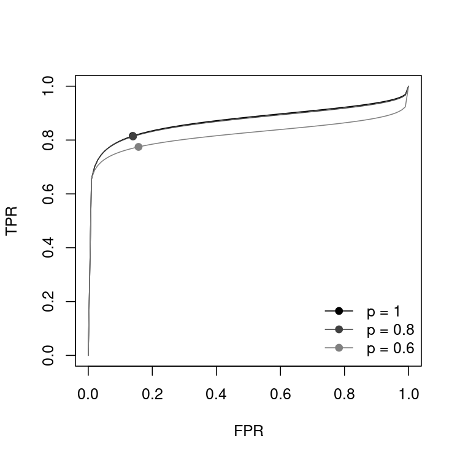

# DiagProMeta

**Sensitivity Analysis for Publication Bias on the SROC Curve**

`DiagProMeta` is an R package for the likelihood-based sensitivity analysis for publication bias

- on the summary receiver operating characteristic (SROC) curve and the area under the SROC curve (SAUC)
  in meta-analysis of diagnostic test accuracy (Zhou et al., 2023), and
- on the time-dependent SROC curve and SAUC in meta-analysis of prognostic studies,
  where the time-dependent sensitivity and specificity are reconstructed from the published
  survival probabilities (Combescure et al., 2016).

The repository is named `srocsa`, but the package name is `DiagProMeta`.

## Installation

The development version can be installed from GitHub:

```r
# install.packages("remotes")
remotes::install_github("kusuri26/srocsa")
```

`DiagProMeta` requires R (>= 3.5) and imports `lifecycle`, `mixmeta`, and `numDeriv`.

## Example

The IVD data (Safdar et al., 2005) contain the 2 x 2 tables (`TP`, `FN`, `FP`, `TN`) of 33 diagnostic studies.

```r
library(DiagProMeta)
data(IVD)

## sensitivity analysis for the marginal selection probabilities p = 1, 0.8, 0.6
fit <- srocsa.t(TP = TP, FN = FN, TN = TN, FP = FP, data = IVD, sa.p = c(1, 0.8, 0.6))
fit
```

```
SAUC Estimates
-------------------------------------------
Marginal p    SAUC      SE   CI.low   CI.up
-------------------------------------------
p = 1        0.874   0.029    0.806   0.920
p = 0.8      0.871   0.030    0.800   0.919
p = 0.6      0.822   0.041    0.727   0.889
```

(Only the SAUC table is shown. `print()` also shows the convergence of the optimizer
and the parameter estimates with their standard errors.)

```r
## tables of the SAUC and the parameter estimates
res <- summary(fit)
res$sauc
res$coef

## SROC curves and summary points for each p
plot(fit)
```



`p = 1` corresponds to no publication bias. A smaller `p` assumes that a smaller proportion of the
studies is published, and the change of the SROC curve and SAUC shows the potential impact of publication bias.

## Methods

### Sensitivity analysis on the SROC curve (`srocsa.t`)

Let $y_{1i}$ and $y_{2i}$ be the logit-transformed sensitivity and specificity of study $i$,
and $v_{1i}$ and $v_{2i}$ be their variances.
The bivariate random-effects model (Reitsma et al., 2005) is

$$
(y_{1i}, y_{2i})^\top \sim N\left((\mu_1, \mu_2)^\top,\ \mathrm{diag}(v_{1i}, v_{2i}) + \Omega\right),
$$

where $\Omega$ has the between-study standard deviations $\tau_1, \tau_2$ and correlation $\rho$.
The probability of publishing study $i$ is modeled by the selection function $\Phi(\alpha + \beta t_i)$ with

$$
t_i = \frac{c_1 y_{1i} + c_2 y_{2i}}{\sqrt{c_1^2 v_{1i} + c_2^2 v_{2i}}}, \quad c_1, c_2 \ge 0, \quad c_1^2 + c_2^2 = 1.
$$

For a given marginal selection probability $p$, $\alpha$ is determined such that the mean of the inverse of the
marginal selection probabilities of the observed studies equals $1/p$.
The model is fitted by the maximum likelihood method for each $p$ in `sa.p`.
$c_1^2$ is estimated by default, or fixed by the argument `c11`.

### Sensitivity analysis on the time-dependent SROC curve (`tsrocsa.lrt`)

At each time point, the time-dependent sensitivity and specificity, and their within-study variances and covariance,
are reconstructed from the survival probabilities of the test-positive and test-negative groups (Combescure et al., 2016).
The logit-transformed sensitivity, specificity, and the log hazard ratio (lnHR) are modeled by the
trivariate random-effects model, combined with the selection function on the $t$-statistic of lnHR.

Three data frames are required:

| Argument    | Content                                                                                      |
|-------------|----------------------------------------------------------------------------------------------|
| `data.os`   | Survival probabilities of the two groups, one row for each study and each time point         |
| `data.lnhr` | lnHR and its variance, one row for each study                                                |
| `data.mct`  | Survival probabilities at the median follow-up time, used to estimate the censoring distribution |

See `?tsrocsa.lrt` for the details of each column.

## Functions

| Function | Description |
|----------|-------------|
| `srocsa.t()` | Sensitivity analysis for publication bias on the SROC curve and SAUC |
| `tsrocsa.lrt()` | Sensitivity analysis for publication bias on the time-dependent SROC curve and SAUC |
| `sroc()` | Bivariate random-effects model for the SROC curve without publication bias |
| `tsroc()` | Time-dependent SROC curve without publication bias |
| `sauc()` | SAUC and its confidence interval (delta method on the logit scale) |
| `print()`, `summary()`, `plot()` | Methods for the `"srocsa"` objects returned by `srocsa.t()`, `tsroc()`, and `tsrocsa.lrt()` |

## Data

| Data | Description |
|------|-------------|
| `IVD` | Meta-analysis of the diagnosis of intravascular device-related bloodstream infection (33 studies) |
| `CD64` | Meta-analysis of neutrophil CD64 for the diagnosis of bacterial infection (27 studies) |
| `IVD_2`, `CD64_2` | Logit-transformed sensitivity and specificity of `IVD` and `CD64`, with their variances |

Example data for the time-dependent analysis are not yet included in the package.

## References

- Zhou Y, Huang A, Hattori S (2023).
  A likelihood-based sensitivity analysis for publication bias on the summary receiver operating characteristic
  in meta-analysis of diagnostic test accuracy.
  *Statistics in Medicine*, 42(6), 781–798.
  [doi:10.1002/sim.9643](https://doi.org/10.1002/sim.9643)
- Combescure C, Daures JP, Foucher Y (2016).
  A literature-based approach to evaluate the predictive capacity of a marker using
  time-dependent summary receiver operating characteristics.
  *Statistical Methods in Medical Research*, 25(2), 674–685.
  [doi:10.1177/0962280212464542](https://doi.org/10.1177/0962280212464542)
- Reitsma JB, Glas AS, Rutjes AW, Scholten RJ, Bossuyt PM, Zwinderman AH (2005).
  Bivariate analysis of sensitivity and specificity produces informative summary measures in diagnostic reviews.
  *Journal of Clinical Epidemiology*, 58(10), 982–990.
  [doi:10.1016/j.jclinepi.2005.02.022](https://doi.org/10.1016/j.jclinepi.2005.02.022)
- Safdar N, Fine JP, Maki DG (2005).
  Meta-analysis: methods for diagnosing intravascular device-related bloodstream infection.
  *Annals of Internal Medicine*, 142(6), 451–466.
  [doi:10.7326/0003-4819-142-6-200503150-00011](https://doi.org/10.7326/0003-4819-142-6-200503150-00011)

## License

GPL (>= 3)
